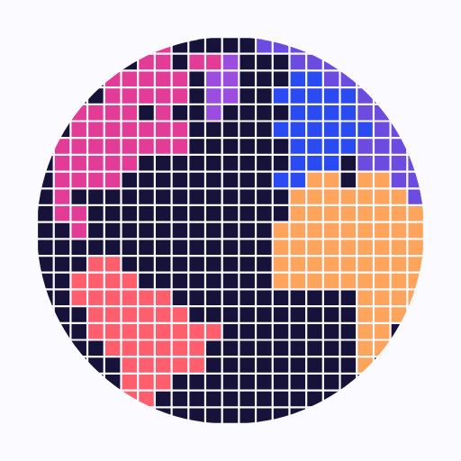

### Hi, I'm Alexander

I run [Neon Atlas](https://neonatlas.uk), a small, independent software company in the UK, and I
design and build its products.

 

**What I'm working on**

<table>
  <tr>
    <td width="88"></td>
    <td><strong><a href="https://cabana.today">Cabana</a></strong> A calendar and nested to-do planner, on the web, iPhone, iPad and Android.</td>
  </tr>
  <tr>
    <td></td>
    <td><strong><a href="https://tracklim.it">tracklimit</a></strong> Formula 1 live timing and telemetry, in the browser and on Android.</td>
  </tr>
  <tr>
    <td></td>
    <td><strong><a href="https://mintelligence.app">mintelligence</a></strong> Adds up a UK online seller's sales for the tax year, box by box for Self Assessment.</td>
  </tr>
  <tr>
    <td></td>
    <td><strong><a href="https://github.com/Neon-Atlas/draw-it-out">draw-it-out</a></strong> A Claude Code plugin that answers questions about your own app from its code. Open source.</td>
  </tr>
  <tr>
    <td></td>
    <td><strong><a href="https://playparagon.app">PARAGON</a></strong> A game in which you raise an AI in a harbour town. Coming soon.</td>
  </tr>
</table>

Most of my work lives in private repositories under [@Neon-Atlas](https://github.com/Neon-Atlas).

**Get in touch:** [alexander@neonatlas.uk](mailto:alexander@neonatlas.uk)
