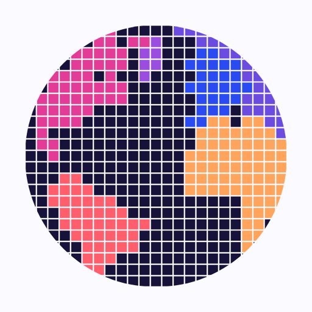
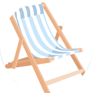
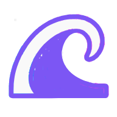

### Hi, I'm Alexander

I run [Neon Atlas](https://neonatlas.uk), a small, independent software company in the UK, and I design and build its products.

 

## Live projects

<table>
  <tr><th colspan="2">Project</th><th>What it does</th><th>Where to use it</th></tr>
  <tr><td width="88"></td><td><strong><a href="https://neonatlas.uk/cabana/">Cabana</a></strong></td><td>A calendar and nested to-do list for planning your days and sharing plans.</td><td><a href="https://cabana.today/">Web</a> · <a href="https://apps.apple.com/app/cabana-planner-to-do-list/id6803259233">App Store</a> · <a href="https://play.google.com/store/apps/details?id=today.cabana.app">Google Play</a></td></tr>
  <tr><td width="88"></td><td><strong><a href="https://neonatlas.uk/paragon/">PARAGON</a></strong></td><td>A multiplayer RPG where you create an AI and play alongside other players in the harbour city of Port Calder.</td><td><a href="https://play.playparagon.app/">Web</a> · <a href="https://apps.apple.com/gb/app/paragon-sentient-city/id6828383489">App Store</a> · <a href="https://play.google.com/store/apps/details?id=app.playparagon.paragon">Google Play</a></td></tr>
  <tr><td width="88"></td><td><strong><a href="https://neonatlas.uk/tracklimit/">tracklimit</a></strong></td><td>Independent Formula 1 live timing, track maps and driver telemetry.</td><td><a href="https://tracklim.it/">Web</a> · <a href="https://apps.apple.com/app/tracklimit-live-race-timing/id6822088045">App Store</a> · <a href="https://play.google.com/store/apps/details?id=it.tracklim.app">Google Play</a></td></tr>
  <tr><td width="88"></td><td><strong><a href="https://neonatlas.uk/hikewatch/">Hikewatch</a></strong></td><td>Tracks software subscriptions and warns small teams about renewals and price changes.</td><td><a href="https://hike.watch/">Web</a></td></tr>
  <tr><td width="88"></td><td><strong><a href="https://neonatlas.uk/creatorflow/">CreatorFlow</a></strong></td><td>A marketplace for YouTube sponsorships that estimates how many viewers will reach each slot and measures delivery after publication.</td><td><a href="https://creatorflow.media/">Web</a></td></tr>
</table>

Most of my work lives in private repositories under [@Neon-Atlas](https://github.com/Neon-Atlas).

[Get in touch](mailto:hello@neonatlas.uk)
